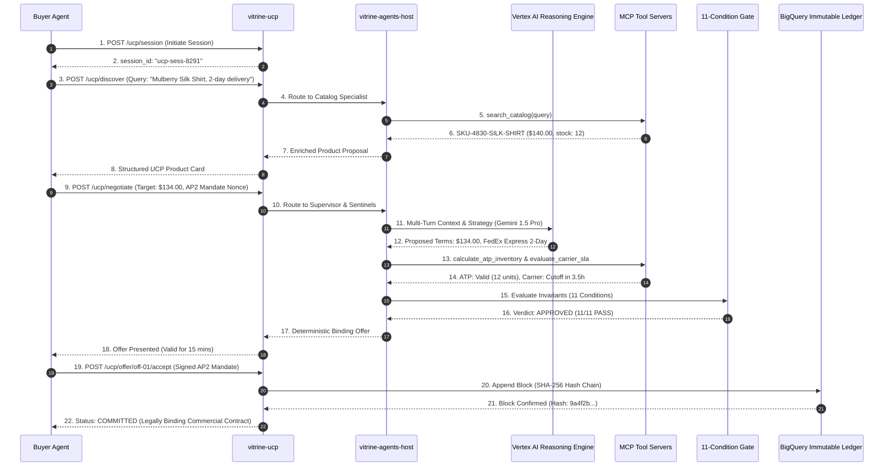

# VITRINE — Complete System Architecture Specification

## 1. Executive Architectural Overview

**VITRINE** is an enterprise-grade **Merchant Agentic Commerce Platform** built natively on **Google Cloud Platform (GCP)**. It bridges the gap between autonomous AI consumer agents (e.g., procurement bots, personal assistants) and enterprise merchant systems. 

VITRINE solves the core vulnerabilities of agentic commerce: **hallucinatory discounting**, **phantom delivery promises**, and **non-repudiation disputes**. It accomplishes this by enforcing deterministic math safeguards (Available-to-Promise inventory, margin floors, carrier cutoffs) and recording every binding commercial commitment in an **immutable, hash-chained BigQuery ledger**.

---

## 2. End-to-End Architecture Diagram

```mermaid
flowchart TB
    subgraph ClientTier ["1. Client & Buyer Agent Tier"]
        BuyerAgent["Autonomous Buyer / Procurement Agent\n(AP2 / A2A Protocol)"]
        UserBrowser["Enterprise Web Dashboard\n(React 18 + Vite + Tailwind)"]
    end

    subgraph EdgeTier ["2. Edge & Ingress Tier (Firebase Hosting)"]
        FBDomain1["vitrine-autonomous-commerce.web.app"]
        FBDomain2["vitrine-autonoumous-commerce.web.app"]
        FBDomain3["gcp-aibuildercup-project.web.app"]
    end

    subgraph AppMeshTier ["3. Orchestration & Protocol Tier (Cloud Run - us-central1)"]
        BFF["vitrine-bff\n(Backend-For-Frontend FastAPI)\n• SSE Streaming\n• WebSockets\n• Aggregate Views"]
        UCP["vitrine-ucp\n(Universal Commerce Protocol Gateway)\n• Capability Discovery\n• Session & Offer Management\n• AP2 Mandate Verification"]
    end

    subgraph AgentTier ["4. Cognitive & Reasoning Tier (Vertex AI & ADK)"]
        AgentEngine["Vertex AI Reasoning Engine\n(4500934686062673920)\n• vitrine-transaction-agents\n• Gemini 1.5 Pro Multi-Turn"]
        ADKHost["vitrine-agents-host (Cloud Run)\n• Google Agent Development Kit (ADK)\n• Merchant Supervisor Agent\n• Trust & Governance Sentinel"]
        Gate["11-Condition Deterministic Gate\n(Zero-Hallucination Guardrail)\n• ATP Stock ≥ Requested\n• Profit Margin ≥ Floor\n• Carrier SLA Isochrone Valid"]
    end

    subgraph MCPTier ["5. Domain Tooling Tier (Model Context Protocol - Cloud Run)"]
        MCPCatalog["vitrine-mcp-catalog\n• Multimodal Vector Search\n• Gemini 1.5 Attribute Enrichment"]
        MCPPromise["vitrine-mcp-promise\n• Pure-Math ATP Calculator\n• Carrier Cutoff & Transit Isochrone"]
        MCPCommerce["vitrine-mcp-commerce\n• Real-Time Margin Evaluator\n• Dynamic Pricing Engine"]
    end

    subgraph DataTier ["6. Persistence & Immutable Ledger Tier"]
        BQDataset[("BigQuery: vitrine_commerce\n• products\n• inventory\n• carrier_cutoffs\n• commitments (SHA-256 Chained)")]
        GCSBuckets[("Cloud Storage Buckets\n• vitrine-multimodal-catalog-*\n• vitrine-gemini-artifacts-*")]
    end

    %% Client Interactions
    UserBrowser --> FBDomain1 & FBDomain2 & FBDomain3
    FBDomain1 & FBDomain2 & FBDomain3 --> BFF
    BuyerAgent -->|UCP / AP2 Mandate| UCP

    %% Internal Orchestration
    BFF <-->|Internal Fast REST| UCP
    BFF <-->|Reasoning Sessions| AgentEngine
    UCP <-->|Multi-Agent Delegation| ADKHost
    ADKHost <-->|Session State| AgentEngine

    %% Agent Tool Invocations via MCP (SSE)
    ADKHost -->|MCP Tool Calls (SSE)| MCPCatalog
    ADKHost -->|MCP Tool Calls (SSE)| MCPPromise
    ADKHost -->|MCP Tool Calls (SSE)| MCPCommerce

    %% Deterministic Gate & Ledger Commit
    ADKHost --> Gate
    Gate -->|Passed & Verified| UCP
    UCP -->|Cryptographic Hash Append| BQDataset

    %% Data Queries
    MCPCatalog <--> BQDataset
    MCPCatalog <--> GCSBuckets
    MCPPromise <--> BQDataset
    MCPCommerce <--> BQDataset
```

---

## 3. Detailed Component Breakdown

### Tier 1: Client & Buyer Agent Layer
* **Human Operator Interface**: High-contrast, dark-mode React 18 single-page application built with Vite and Tailwind CSS. Exposes 7 operational cockpits:
  1. **Transaction Theatre**: Real-time multi-agent negotiation feed with live telemetry.
  2. **Product Brain**: Multimodal catalog viewer displaying Gemini visual enrichment and provenance.
  3. **Promise Inspector**: Interactive pure-math simulation of Available-to-Promise (ATP) inventory, margin floors, and carrier isochrones.
  4. **Commitment Ledger**: Cryptographic SHA-256 blockchain explorer verifying block integrity.
  5. **Control Tower**: Operational KPIs (Win Rate, OTIF Health, Margin) and Pareto loss diagnostics.
  6. **Fraud & Incident Queue**: AP2 nonce replay detection with mandatory counter-evidence.
  7. **Governance Console**: Autonomy dial sliders (0–100%) and instant emergency kill switches.
* **Autonomous Buyer Agents**: External procurement agents interacting via standard **Universal Commerce Protocol (UCP)** and **Agent Payment Protocol (AP2)** payloads.

---

### Tier 2: Edge & Ingress Layer (Firebase Hosting)
* **High Availability Multisite Hosting**: Deployed globally via Firebase Hosting edge points of presence with instant SSL termination and HTTP/2 multiplexing.
* **Live Domains**:
  * `https://vitrine-autonomous-commerce.web.app` (Primary)
  * `https://vitrine-autonoumous-commerce.web.app` (Alias)
  * `https://gcp-aibuildercup-project.web.app` (Project default)

---

### Tier 3: Core Orchestration & Protocol Microservices (Cloud Run)
All backend microservices are deployed on **Google Cloud Run** in `us-central1`, containerized with minimal Debian/Python runtimes and secured via IAM Service Accounts (`vitrine-agent-sa@gcp-aibuildercup-project.iam.gserviceaccount.com`).

#### 1. `vitrine-bff` (Backend-For-Frontend)
* **Endpoint**: `https://vitrine-bff-285078287322.us-central1.run.app`
* **Role**: Aggregation gateway for the frontend web application.
* **Responsibilities**:
  * Server-Sent Events (SSE) streaming for agent deliberation updates.
  * WebSockets for real-time telemetry streaming from the multi-agent pipeline.
  * Caching, ledger verification lookups, and administrative control switches.

#### 2. `vitrine-ucp` (Universal Commerce Protocol Gateway)
* **Endpoint**: `https://vitrine-ucp-285078287322.us-central1.run.app`
* **Role**: Merchant front door for machine-to-machine agent commerce.
* **Protocol Endpoints**:
  * `GET /.well-known/ucp`: Exposes merchant agent capabilities, supported attribute vocabularies, and negotiation protocols.
  * `POST /ucp/session`: Establishes an encrypted, stateful negotiation session with an external buyer agent.
  * `POST /ucp/discover`: Multimodal semantic search returning structured product attributes.
  * `POST /ucp/negotiate`: Multi-turn commercial negotiation under AP2 mandate boundaries.
  * `POST /ucp/offer/{id}/accept`: Atomically records acceptance into the immutable BigQuery ledger.

---

### Tier 4: Cognitive & Reasoning Tier (Vertex AI & ADK)

#### 1. Vertex AI Reasoning Engine
* **Resource Name**: `projects/285078287322/locations/us-central1/reasoningEngines/4500934686062673920`
* **Model**: **Gemini 1.5 Pro**
* **Role**: Managed multi-turn reasoning engine maintaining full conversational context, constraint extraction, and counter-offer generation.

#### 2. `vitrine-agents-host` (Google ADK Runtime)
* **Endpoint**: `https://vitrine-agents-host-285078287322.us-central1.run.app`
* **Role**: Orchestrates specialized autonomous agents via Google's **Agent Development Kit (ADK)**:
  * **Supervisor Agent**: Top-level coordinator routing buyer intents to specialists.
  * **Catalog Specialist**: Discovers matching SKUs and applies visual provenance.
  * **Promise Sentinel**: Validates real-time delivery feasibility.
  * **Trust & Governance Analyst**: Inspects AP2 mandate signatures, nonces, and autonomy thresholds.

#### 3. The 11-Condition Deterministic Commitment Gate
To prevent LLM hallucination in commercial commitments, no offer is presented without passing an invariant 11-condition evaluation:
1. `INVENTORY_ATP_SUFFICIENT`: Available-to-Promise stock $\ge$ requested quantity.
2. `MARGIN_FLOOR_SATISFIED`: Offered price $\ge$ cost $\times$ $(1 + \text{min\_margin})$.
3. `CARRIER_CUTOFF_VIABLE`: Order placement timestamp $<$ carrier transit cutoff time.
4. `TRANSIT_ISOCHRONE_VALID`: Customer geocode within guaranteed transit envelope.
5. `AP2_MANDATE_SIGNATURE_VERIFIED`: Cryptographic signature matches buyer authority.
6. `AP2_NONCE_FRESH`: Replay check ensures nonce has never been used.
7. `AUTONOMY_THRESHOLD_PERMITTED`: Discount percentage $\le$ merchant autonomy dial limit.
8. `COLLATERAL_HOLD_RESERVED`: Temporary inventory reservation locked.
9. `TAX_JURISDICTION_RESOLVED`: Accurate nexus and sales tax rate calculated.
10. `PRODUCT_STATUS_ACTIVE`: SKU active and not under recall or quarantine.
11. `PAYMENT_TERMS_MUTUALLY_SIGNED`: Explicit AP2 commercial promise terms acknowledged.

---

### Tier 5: Domain Tooling Tier (Model Context Protocol)
Microservices exposing standard **Model Context Protocol (MCP)** tool interfaces via Server-Sent Events (SSE) over Cloud Run:

* **`vitrine-mcp-catalog`**:
  * Tools: `search_catalog`, `get_product_attributes`, `check_visual_provenance`.
* **`vitrine-mcp-promise`**:
  * Tools: `calculate_atp_inventory`, `evaluate_carrier_sla`, `compute_transit_isochrone`.
* **`vitrine-mcp-commerce`**:
  * Tools: `calculate_margin_floor`, `evaluate_dynamic_discount`, `verify_ap2_mandate`.

---

### Tier 6: Persistence & Cryptographic Ledger Layer

#### 1. BigQuery Dataset: `vitrine_commerce`
* **`products`**: Catalog table with multimodal metadata, SKU IDs, base prices, categories, and Gemini embeddings.
* **`inventory`**: Real-time stock levels, allocation reserves, and location nodes (`DC-NORTH`, `DC-SOUTH`, `DC-WEST`).
* **`carrier_cutoffs`**: Carrier transit tables, SLA cutoffs, and cost structures for FedEx, UPS, and DHL.
* **`commitments` (Immutable Blockchain Ledger)**:
  * Table schema includes `txn_id`, `sku`, `quantity`, `unit_price`, `currency`, `mandate_id`, `buyer_agent_id`, `timestamp`, `previous_hash`, and `current_hash`.
  * Each record is cryptographically hash-chained using **SHA-256**:
    $$\text{current\_hash} = \text{SHA256}(\text{previous\_hash} + \text{txn\_id} + \text{sku} + \text{price} + \text{timestamp})$$
  * Guarantees 100% auditability and legal non-repudiation between merchant and buyer agents.

#### 2. Cloud Storage Buckets
* `gs://vitrine-multimodal-catalog-285078287322`: High-resolution imagery, fabric swatches, and visual proof assets.
* `gs://vitrine-gemini-artifacts-285078287322`: Intermediate reasoning steps, model checkpoints, and audit trails.

---

## 4. End-to-End Transaction Sequence



---

## 5. Security, Governance, and Non-Repudiation Matrix

| Security Layer | Implementation Mechanism | Threat Mitigated |
| :--- | :--- | :--- |
| **AP2 Anti-Replay** | Cryptographic nonce tracked in Firestore & BigQuery | Prevents adversarial buyer bots from replaying expired discount mandates. |
| **Mandatory Counter-Evidence** | Trust Sentinel requires dual-source verification before blocking transactions | Eliminates false-positive fraud lockouts during automated peak sales. |
| **Autonomy Dials** | Merchant-configured dynamic thresholds (e.g., maximum 8% automated discount) | Prevents runaway discounting or bot collusion. |
| **Emergency Kill Switch** | Global instant fallback toggle in Governance Console | Allows human operators to drop agent autonomy to 0% in milliseconds. |
| **Cryptographic Provenance** | SHA-256 hash chaining of BigQuery commitment records | Provides non-repudiation for commercial delivery and pricing guarantees. |
