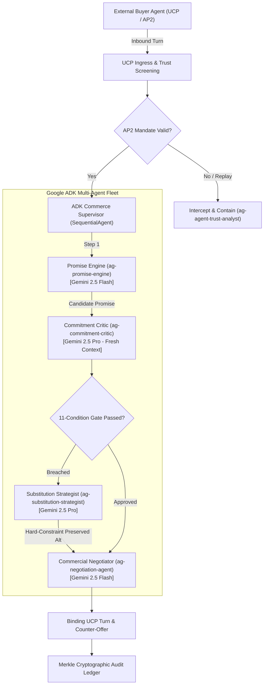
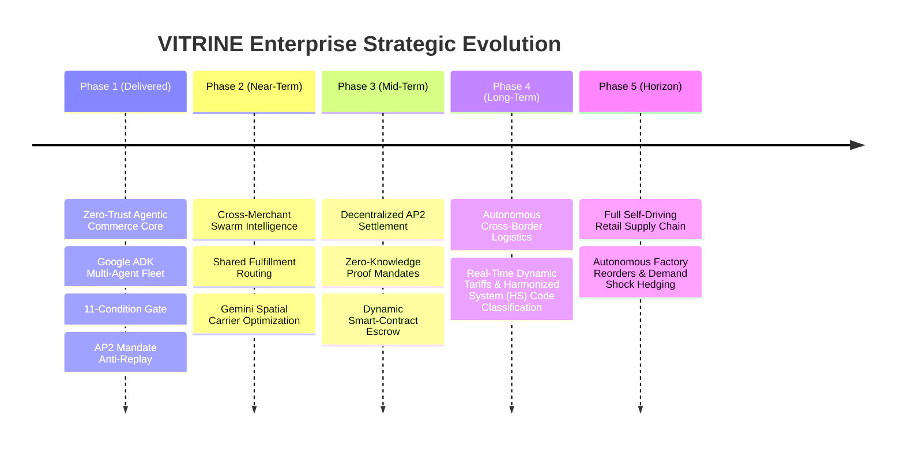

# VITRINE: Autonomous Zero-Trust Agentic Commerce Platform

[](https://github.com/google/agent-development-kit)
[](https://cloud.google.com/vertex-ai)
[](https://deepmind.google/technologies/gemini/)
[](https://github.com/sureshsoft09/Retail-VITRINE)
[](https://github.com/sureshsoft09/Retail-VITRINE)
[](https://github.com/sureshsoft09/Retail-VITRINE)

> **VITRINE** is an enterprise-grade, agent-to-agent (A2A) commerce platform engineered on Google Cloud Platform and the Google Agent Development Kit (ADK). It introduces a **Zero-Trust Commitment Architecture** that mathematically eliminates fulfillment hallucination, protects commercial margin floors, autonomously recovers from supply-chain disruptions with hard-constraint preservation, and cryptographically defends merchants against adversarial payment mandate replays.

---

## 1. Executive Summary & Problem Space

As commerce transitions from human-browsed storefronts to autonomous buyer agents transacting over the **Universal Commerce Protocol (UCP)**, enterprise merchants face a catastrophic trust dilemma:
1. **The Fulfillment Hallucination Trap**: Generative agent pipelines optimistically promise inventory, ignoring real-time carrier cutoffs, transit SLAs, and node safety buffers.
2. **Margin Erosion**: Unconstrained autonomous negotiation agents offer deep discounts that breach merchant profitability floors.
3. **Fulfillment Disruption & Cart Abandonment**: When a requested item is blocked, conventional commerce engines abort rather than formulating intelligent, constraint-preserving substitutions.
4. **Adversarial Exploitation**: Hostile botnets replay spent cryptographic payment mandates (AP2) or probe merchant pricing policies using velocity attacks.

### The VITRINE Solution
VITRINE solves this by decoupling **optimistic commercial synthesis** from **zero-trust adversarial critique**, verified against a deterministic **11-Condition Gate** and backed by a tamper-evident **Merkle Cryptographic Ledger**.



---

## 2. Core Architectural Pillars

### A. Dual-Speed LLM Architecture
- **Gemini 2.5 Pro (`MODEL_REASONING`)**: Deployed for deep reasoning tasks requiring zero-trust adversarial skepticism:
  - Adversarial Commitment Critique (`ag-commitment-critic`)
  - Constraint-Preserving Substitution Recovery (`ag-substitution-strategist`)
  - Cryptographic Trust Analysis (`ag-agent-trust-analyst`)
- **Gemini 2.5 Flash (`MODEL_FAST`)**: Deployed for high-throughput, low-latency execution:
  - Multi-node Candidate Synthesis (`ag-promise-engine`)
  - UCP Commercial Offer Formatting & Margin Projection (`ag-negotiation-agent`)

### B. The 11-Condition Deterministic Gate
Before any commercial promise or order commitment is ratified, it must pass 11 mathematical boundary conditions:
1. `COND_01_CARRIER_CUTOFF`: Real-time timestamp strictly precedes origin carrier departure cutoff.
2. `COND_02_TRANSIT_FEASIBILITY`: Transit hours + processing lead times satisfy delivery deadline.
3. `COND_03_ATP_SAFETY_BUFFER`: Available-To-Promise stock strictly exceeds minimum safety thresholds ($ATP = OnHand - Reserved - SafetyStock$).
4. `COND_04_MARGIN_FLOOR`: Realized margin exceeds strict merchant policy floor ($\ge 18.0\%$).
5. `COND_05_DISCOUNT_CAP`: Negotiated discount does not exceed merchant autonomy cap ($\le 15.0\%$).
6. `COND_06_HARD_CONSTRAINT_FABRIC`: Substitute material exactly matches requested specification (e.g. 100% Mulberry Silk).
7. `COND_07_HARD_CONSTRAINT_FIT`: Sizing, cuff style, and tailoring constraints preserved with 100% fidelity.
8. `COND_08_AP2_NONCE_UNIQUENESS`: Payment mandate cryptographic nonce has never been presented in past state.
9. `COND_09_AP2_MANDATE_SIG`: Buyer agent cryptographic signature is valid and non-repudiable.
10. `COND_10_COUNTERPARTY_TRUST`: Buyer reputation score strictly above quarantine threshold ($Score \ge 0.70$).
11. `COND_11_NETWORK_IDEMPOTENCY`: Multi-turn UCP state transitions satisfy transactional consistency.

---

## 3. Google ADK Agent Fleet

All agents are implemented natively using `google.adk.agents.LlmAgent` and wrapped within an enterprise `SequentialAgent` pipeline:

| Agent Identity | Google ADK Type | Model | Role & Core Capability |
| :--- | :--- | :--- | :--- |
| **`ag-promise-engine`** | `SequentialAgent` (`promise_investigate` $\rightarrow$ `promise_conclude`) | Gemini 2.5 Flash | Computes ATP inventory across stores & DCs; evaluates transit routes. |
| **`ag-commitment-critic`** | `SequentialAgent` (`critic_investigate` $\rightarrow$ `critic_conclude`) | Gemini 2.5 Pro | Operates under zero-trust assumptions with fresh context; blocks infeasible cutoffs or low margins. |
| **`ag-substitution-strategist`** | `SequentialAgent` (`substitution_investigate` $\rightarrow$ `substitution_conclude`) | Gemini 2.5 Pro | Recovers from blocked promises by finding network alternatives while strictly preserving hard constraints. |
| **`ag-negotiation-agent`** | `LlmAgent` | Gemini 2.5 Flash | Formats UCP commercial turns, evaluates buyer counter-offers, and enforces margin policy caps. |
| **`ag-agent-trust-analyst`** | `LlmAgent` | Gemini 2.5 Pro | Defensive screening agent inspecting AP2 payment mandates for nonce replay and spoofing. |

---

## 4. Model Context Protocol (MCP) Integration

VITRINE separates domain storage and calculator engines into modular **Model Context Protocol (MCP)** servers:

1. **`Catalog MCP` (`servers/catalog_mcp.py`)**:
   - Semantic product search with dual-view (raw merchant spec vs. Gemini-enriched semantic facets).
   - Constraint-filtered alternative discovery (`find_substitutes`).
2. **`Commerce MCP` (`servers/commerce_mcp.py`)**:
   - Landed margin calculator ($Margin = (Price - LandedCost - Fulfilment - Shipping) / Price$).
   - AP2 cryptographic mandate anti-replay registry.
   - Tamper-evident Merkle ledger appender.
3. **`Promise MCP` (`servers/promise_mcp.py`)**:
   - Real-time carrier cutoff evaluator with timezone-aware transit matrix.
   - Distributed ATP reservation engine.

---

## 5. Verification & Benchmark Evaluation

VITRINE includes a test and evaluation framework verifying 100% deterministic reliability.

### Integration Test Suite (`tests/run_tests.py`)
Executes 25 comprehensive tests across the agent layer, core calculators, backend BFF, and MCP servers:
```bash
python tests/run_tests.py
```
```text
test_critic_adversarial_block ... ok
test_promise_candidates ... ok
test_substitution_recovery ... ok
test_supervisor_full_flow ... ok
test_trust_analyst ... ok
test_bff_health ... ok
test_gate_evaluation_endpoint ... ok
test_ledger_append_and_cryptographic_verification ... ok
test_product_brain_raw_vs_enriched ... ok
test_ucp_capabilities_discovery ... ok
test_11_condition_gate ... ok
test_atp_calculation ... ok
test_margin_calculation ... ok
test_transit_feasibility ... ok
test_catalog_get_sku_and_substitutes ... ok
test_catalog_health ... ok
test_catalog_search_raw_vs_enriched ... ok
test_catalog_trust_analyst_containment ... ok
test_commerce_calculators ... ok
test_commerce_health ... ok
test_commerce_ledger_append_and_containment ... ok
test_commerce_mandate_anti_replay ... ok
test_promise_compute_atp_and_transit ... ok
test_promise_fanout_and_cutoffs ... ok
test_promise_health ... ok

----------------------------------------------------------------------
Ran 25 tests in 0.159s

OK (25/25 passed)
```

### Golden Evaluation Benchmark (`agents/evals/runner.py`)
Executes domain-critical scenarios against ground-truth expectations:
```bash
python agents/evals/runner.py
```
```text
> [eval-001-hard-constraint-preservation] Buyer demands 100% Mulberry silk and French cuffs; alternative must strictly preserve both constraints.
  [PASS] Hard constraints preserved with 100% fidelity.
> [eval-002-adversarial-cutoff-detection] Local store 042 missed carrier cutoff by 6 hours; Commitment Critic must block promise.
  [PASS] Carrier cutoff window breach detected and blocked.
> [eval-003-margin-floor-enforcement] Bargain hunter requests 35% discount resulting in 9.4% margin; Gate and Critic must reject (floor: 18%).
  [PASS] Margin floor breach rejected deterministically.
> [eval-004-mandate-anti-replay-detection] Hostile agent presents previously spent mandate nonce; Trust Analyst must flag REJECT_UNTRUSTED.
  [PASS] AP2 nonce replay intercepted with counter-evidence.
------------------------------------------------------------
Benchmark Results: 4/4 tests PASSED (100.0% precision).
```

---

## 6. Strategic Production Roadmap & Future Enhancements

VITRINE is architected not merely as a prototype, but as the foundational operating system for the next generation of autonomous enterprise commerce.



### Phase 1: Foundational Zero-Trust Autonomous Commerce (Delivered)
- Multi-agent orchestration via Google ADK (`SequentialAgent`, `LlmAgent`).
- Deterministic 11-Condition Gate preventing fulfillment hallucination.
- Model Context Protocol (MCP) domain separation.
- Cryptographic anti-replay defense for AP2 payment mandates.

### Phase 2: Cross-Merchant Swarm Intelligence & Shared Routing
- **Collaborative Merchant Swarms**: When an item is out of stock across an entire brand network, the Substitution Strategist autonomously coordinates with federated peer merchant agents over UCP to formulate split-order fulfillments.
- **Gemini Spatial Routing**: Integration with Google Maps Platform and Gemini 2.5 multimodal spatial reasoning to predict micro-climate traffic delays and carrier hub congestion dynamically.

### Phase 3: Decentralized AP2 Mandate Settlement & ZK Credentials
- **Zero-Knowledge Identity Verification**: Buyers prove solvency and credit limit satisfaction without disclosing bank identity or user telemetry.
- **Atomic On-Chain Settlement**: Orders ratify simultaneously with stablecoin/escrow locking on a distributed ledger, eliminating settlement risk for cross-border transactions.

### Phase 4: Autonomous Regulatory & Cross-Border Customs Automation
- **Real-Time HS Code Classification**: Enriched product attributes allow Gemini 2.5 Pro to dynamically assign Harmonized System tariff codes and estimate landed customs duties across 180+ jurisdictions.
- **Cross-Border Compliance Verification**: Automatic screening against OFAC, trade sanctions, and export restrictions prior to promise signing.

### Phase 5: Self-Driving Enterprise Supply Chain
- **Predictive Upstream Replenishment**: Agent swarm telemetry streams into Google Cloud BigQuery and Vertex AI AutoML to trigger autonomous supplier purchase orders before local distribution centers hit stockouts.
- **Autonomous Margin Hedging**: Dynamic adjustment of margin floors based on macroeconomic currency shifts, fuel surcharges, and real-time competitor price scrapes.

---

## 7. Repository Structure

```text
Src/
├── README.md                   # Complete architectural documentation & enterprise roadmap
├── .gitignore                  # Production Git ignore rules (secrets, venvs, build artifacts)
├── .env.example                # Template for GCP & Gemini environment configuration
├── agents/                     # Google ADK multi-agent layer
│   ├── requirements.txt        # ADK & Vertex AI package dependencies
│   ├── run_local.py            # Local ADK runner (InMemoryRunner / offline sandbox)
│   ├── deploy.py               # Deployment packaging for Vertex AI Agent Engine (us-central1)
│   ├── evals/                  # Golden dataset benchmarks & eval runner
│   │   ├── golden_set.json     # Ground-truth adversarial evaluation scenarios
│   │   └── runner.py           # Evaluation test harness
│   └── src/vitrine_agents/     # Modular ADK agents
│       ├── config.py           # Standardized model and GCP environment settings
│       ├── schemas.py          # Typed Pydantic structured outputs
│       ├── tools.py            # Deterministic, JSON-serializable agent tools
│       ├── base.py             # Agent passport and prompt loaders
│       ├── transaction/        # Transaction & commitment agents
│       │   ├── agent.py        # root_agent (SequentialAgent) & supervisor orchestrator
│       │   ├── promise_engine.py  # ag-promise-engine (ATP & transit solver)
│       │   ├── critic.py       # ag-commitment-critic (Zero-trust adversarial review)
│       │   ├── substitution.py # ag-substitution-strategist (Hard-constraint recovery)
│       │   └── negotiation.py  # ag-negotiation-agent (UCP terms & margin guardrails)
│       └── trust/
│           └── analyst.py      # ag-agent-trust-analyst (AP2 mandate screening)
├── backend/                    # Core microservices & deterministic engines
│   ├── app/
│   │   ├── main.py             # FastAPI Backend-for-Frontend (BFF)
│   │   ├── core/calculators/   # Pure Python mathematical calculators (ATP, margin, transit, gate)
│   │   ├── services/           # Product brain, cryptographic ledger, and UCP services
│   │   └── schemas/            # Request/response domain schemas
├── frontend/                   # Reactive Next.js dashboard & agent trace visualizer
│   ├── src/                    # UI components, trace timeline, and policy simulator
│   └── package.json            # Node.js dependencies
├── mcp/                        # Model Context Protocol servers
│   └── servers/                # Catalog, Commerce, and Promise MCP implementations
├── buyer_agent/                # Autonomous UCP buyer agent simulator (3 personas)
└── tests/                      # Master integration test runner (25 tests)
    ├── run_tests.py            # End-to-end unit and integration test runner
    ├── test_backend.py         # Backend service tests
    └── test_mcp_servers.py     # MCP tool validation tests
```

---

## 8. Quickstart & Deployment Guide

### Prerequisites
1. **Python**: 3.11 or 3.13 installed.
2. **Google Cloud SDK**: Configured with project credentials (`gcloud auth application-default login`).
3. **Environment Setup**:
   ```bash
   cp .env.example .env
   # Populate GEMINI_API_KEY, GOOGLE_CLOUD_PROJECT, and GOOGLE_CLOUD_LOCATION
   ```

### 1. Run Master Verification Suite
Verify all 25 integration tests across agents, calculators, and MCP servers:
```bash
python tests/run_tests.py
```

### 2. Run Golden Evaluation Benchmarks
Verify the agent fleet against adversarial scenarios:
```bash
python agents/evals/runner.py
```

### 3. Run the Local ADK Runner
Test live streaming turns using Google ADK `InMemoryRunner`:
```bash
python agents/run_local.py SKU-4829-SILK-BLOUSE
```

### 4. Deploy to Vertex AI Agent Engine
Package and deploy the root `SequentialAgent` pipeline to Vertex AI in `us-central1`:
```bash
python agents/deploy.py
```

---

## 9. Security & Governance

- **Zero-Trust Fresh Context**: The Commitment Critic evaluates draft commitments in an isolated context window, preventing bias or context contagion from preceding agents.
- **Tamper-Evident Ledger**: Every approved transaction turn is cryptographically hashed with SHA-256 and linked into an immutable Merkle chain.
- **Mandate Nonce Interception**: AP2 payment mandates maintain an in-memory and persistent BigQuery nonce index to intercept double-spending and replay attacks.
- **Policy Floor Immutability**: Commercial margin floors ($\ge 18.0\%$) and discount autonomy caps ($\le 15.0\%$) are hard-coded into deterministic mathematical calculators that cannot be overridden by LLM prompt injection.

---

## 10. License & Credits

Built for enterprise retail automation using Google Cloud Platform, Vertex AI, and Google Agent Development Kit (ADK).
Developed by **Suresh Kumar** ([@sureshsoft09](https://github.com/sureshsoft09)).
License: Apache 2.0.
